<!--
  업로드 방법: hoooni10099/hoooni10099 저장소에 README.md 와 assets 폴더(header-dark.svg, header-light.svg)를 함께 올리기
  [대괄호] 부분만 채우거나 지우면 됩니다.
-->

<picture>
  <source media="(prefers-color-scheme: dark)"  srcset="./assets/header-dark.svg">
  <source media="(prefers-color-scheme: light)" srcset="./assets/header-light.svg">
  
</picture>

<h1 align="left">
  이상훈 <sub><sup>/ Embedded Full-Stack Developer</sup></sub>
</h1>

<a href="https://git.io/typing-svg"></a>

<br/>

```c
/* whoami.h */
typedef struct {
    const char *name;       // "Lee Sang Hun"
    const char *role;       // "Embedded Full-Stack Developer"
    const char *layers[4];  // { "Firmware", "Embedded", "Data", "Analytics" }
    const char *focus;      // "Predictive Maintenance · Smart Factory (MES)"
    const char *certs[2];   // { "SQLD", "ADsP" }
    const char *contact;    // "lshun3604@gmail.com"
} engineer_t;

volatile uint8_t curiosity = 0xFF;   // always max
```

<br/>

## ▣ The Stack I Live In

> 전기 신호 하나가 판단 가능한 데이터가 되기까지, 전 구간을 직접 만듭니다.

```text
  ┌───────────────────────────────────────────────────────┐
  │  INSIGHT   Streamlit · Plotly · pandas · Z-score       │  ← 보여주고, 판단하고
  ├───────────────────────────────────────────────────────┤
  │  DATA      PostgreSQL · SQLite                         │  ← 쌓고, 질의하고
  ├───────────────────────────────────────────────────────┤
  │  APP       Python · Java                               │  ← 수집하고, 처리하고
  ├───────────────────────────────────────────────────────┤
  │  EMBEDDED  Raspberry Pi · Linux (Ubuntu/WSL) · ROS     │  ← 엣지에서 돌리고
  ├───────────────────────────────────────────────────────┤
  │  FIRMWARE  C · C++ · STM32 · Arduino · UART/Serial     │  ← 하드웨어를 깨우고
  └───────────────────────────────────────────────────────┘
                  ⚡ sensor / MCU / silicon
```

<br/>

## ▤ Toolbox

<table>
  <tr>
    <td width="110"><sub><b>Language</b></sub></td>
    <td></td>
  </tr>
  <tr>
    <td><sub><b>Hardware</b></sub></td>
    <td>
      
      
    </td>
  </tr>
  <tr>
    <td><sub><b>Database</b></sub></td>
    <td></td>
  </tr>
  <tr>
    <td><sub><b>Data · Viz</b></sub></td>
    <td>
      
      
      
      
    </td>
  </tr>
  <tr>
    <td><sub><b>Robotics</b></sub></td>
    <td>
      
      
      
      
    </td>
  </tr>
  <tr>
    <td><sub><b>Env</b></sub></td>
    <td></td>
  </tr>
</table>

<br/>

## ▩ Certified Modules

<table>
  <tr>
    <td width="50%" valign="top">
      
      <br/><sub>한국데이터산업진흥원 · 데이터 모델링 & SQL 활용</sub>
    </td>
    <td width="50%" valign="top">
      
      <br/><sub>한국데이터산업진흥원 · 데이터 이해 · 분석 기획 · 통계 분석</sub>
    </td>
  </tr>
</table>

<br/>

## ▥ Selected Work

<table>
  <tr>
    <td width="50%" valign="top">
      <h3>📡 <a href="https://github.com/hoooni10099/PdM_monitoring_pipeline">PdM Monitoring Pipeline</a></h3>
      <sub>Arduino 센서 노드에서 대시보드까지 — 설비 고장을 <b>일어나기 전에</b> 잡는 예지보전 시스템</sub>
      <br/><br/>
<sub>

```
Arduino ─serial─▶ Collector ─▶ PostgreSQL
                                  │
          Dashboard ◀── Analysis ◀┘
```

</sub>
      <sub>▸ 충격·온습도·거리·화염 4종 센서 → 115200bps 시리얼 프로토콜 설계<br/>
      ▸ 규칙 기반 + Z-score(2.5σ) 이상 탐지, 8개 시나리오 검증<br/>
      ▸ SQLite → PostgreSQL 이관, MVCC로 수집·분석·시각화 3개 프로세스 독립 운영</sub>
      <br/><br/>
      <code>Arduino</code> <code>Python</code> <code>PostgreSQL</code> <code>Streamlit</code>
    </td>
    <td width="50%" valign="top">
      <h3>🏭 <a href="https://github.com/hoooni10099/Dx-Ax">Dx-Ax</a></h3>
      <sub>C · C++ · Java · Python · SQLite를 넘나들며 쌓은 <b>737 commits</b>의 학습·프로젝트 아카이브</sub>
      <br/><br/>
      <sub>▸ <b>Mini MES Project</b> — BOM · Routing · LOT 기반 공정실적, EOL 검사, Serial · LOT 양방향 추적<br/>
      ▸ 언어별 실습 코드와 SQLite 데이터 설계<br/>
      ▸ WSL(Ubuntu) 기반 개발 환경 구성</sub>
      <br/><br/>
      <code>C/C++</code> <code>Java</code> <code>Python</code> <code>SQLite</code>
    </td>
  </tr>
  <tr>
    <td width="50%" valign="top">
      <h3>🤖 <a href="https://github.com/hoooni10099/Cobot_Palletizing">Cobot Pick &amp; Palletizing</a></h3>
      <sub>Neuromeka 협동로봇을 Conty 펜던트로 티칭해 피더 → 팔레트 <b>2×2 · 2단 적층</b>까지 자동화한 실습</sub>
      <br/><br/>
<sub>

```
Feeder ─Pick─▶ Palletize p1
  ▲               │ WP1→WP4
  └── Loop ×4 ◀───┘ layer2 +35.7mm
```

</sub>
      <sub>▸ Loop · Pick · Palletize로 반복 동작 구조화, 칸 간격 약 78mm<br/>
      ▸ 같은 네 칸을 한 단 높이만큼 올려 재티칭해 2단 적재<br/>
      ▸ 컨트롤 박스 DO.02로 진공 석션컵 on/off, 병 이송 · 상자 적재까지</sub>
      <br/><br/>
      <code>Neuromeka</code> <code>Conty</code> <code>Palletizing</code> <code>Digital I/O</code>
    </td>
    <td width="50%" valign="middle" align="center">
      <a href="https://github.com/hoooni10099/Cobot_Palletizing"></a>
    </td>
  </tr>
  <tr>
    <td width="50%" valign="middle" align="center">
      <a href="https://github.com/hoooni10099/ROS_TurtleBot3_Autonomous_Driving"></a>
      <br/>
      <a href="https://github.com/hoooni10099/ROS_TurtleBot3_Autonomous_Driving"></a>
    </td>
    <td width="50%" valign="top">
      <h3>🛞 <a href="https://github.com/hoooni10099/ROS_TurtleBot3_Autonomous_Driving">ROS TurtleBot3 Autonomous Driving</a></h3>
      <sub>ROS Noetic · TurtleBot3로 <b>LiDAR SLAM → AMCL 위치 추정 → 목표 지점 주행</b>, 카메라 차선 인식까지 묶은 VisionDrive</sub>
      <br/><br/>
<sub>

```
LiDAR ─▶ Gmapping ─▶ map ─▶ AMCL ─┐
Camera ─▶ BEV ─▶ detect_lane ─┐   ▼
           control_lane ─▶ /cmd_vel ◀─ move_base
```

</sub>
      <sub>▸ 텔레옵 매핑 → map_saver → 2D Pose Estimate · Nav Goal로 자율 주행<br/>
      ▸ 어안 카메라 내부 · 외부 보정, HSV 노란선 · 흰선 검출로 차선 추종<br/>
      ▸ rqt_graph로 /cmd_vel 이중 발행 구조를 찾아 개선 과제로 정리</sub>
      <br/><br/>
      <code>ROS Noetic</code> <code>Gmapping</code> <code>AMCL</code> <code>move_base</code> <code>OpenCV</code>
    </td>
  </tr>
</table>

<br/>

## ▦ Boot Log

```console
[    0.000000] Booting Lee Sang Hun ...
[    0.104213] lang: C / C++ / Java / Python loaded ............................. [  OK  ]
[    1.337000] db: SQLite schema design, MES data modeling ....................... [  OK  ]
[    2.048000] fw: Arduino 4-sensor node, serial protocol, debounce .............. [  OK  ]
[    2.718281] cert: SQLD, ADsP (K-data) verified ................................ [ PASS ]
[    3.141592] data: PdM pipeline, SQLite → PostgreSQL migration ................. [  OK  ]
[    3.600000] robot: Neuromeka cobot, Conty teaching, 2x2 · 2-layer palletizing . [  OK  ]
[    3.850000] ros: TurtleBot3 SLAM · AMCL nav · camera lane following ......... [  OK  ]
[    4.096000] now: [STM32 / Raspberry Pi 확장 · 진행 중인 일] ...................... [ BUSY ]
[    ∞       ] waiting for next interrupt_
```

<br/>

## ▧ Signals

<picture>
  <source media="(prefers-color-scheme: dark)"  srcset="https://github-readme-stats.vercel.app/api?username=hoooni10099&show_icons=true&hide_border=true&bg_color=00000000&title_color=2BD67B&icon_color=2BD67B&text_color=c9d1d9&hide_title=true&rank_icon=percentile">
  
</picture>
<picture>
  <source media="(prefers-color-scheme: dark)"  srcset="https://github-readme-stats.vercel.app/api/top-langs/?username=hoooni10099&layout=donut-vertical&hide_border=true&bg_color=00000000&text_color=c9d1d9&hide_title=true&langs_count=5">
  
</picture>

<br/>

## ▨ Interrupt Me

<a href="mailto:lshun3604@gmail.com"></a>
<a href="https://github.com/hoooni10099"></a>
<!-- 블로그/LinkedIn 있으면 추가:
<a href="URL"></a>
-->

<br/><br/>

<p align="right">
  <sub><code>while (1) { learn(); build(); __WFI(); }</code></sub>
</p>
